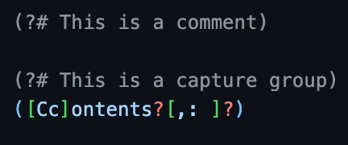
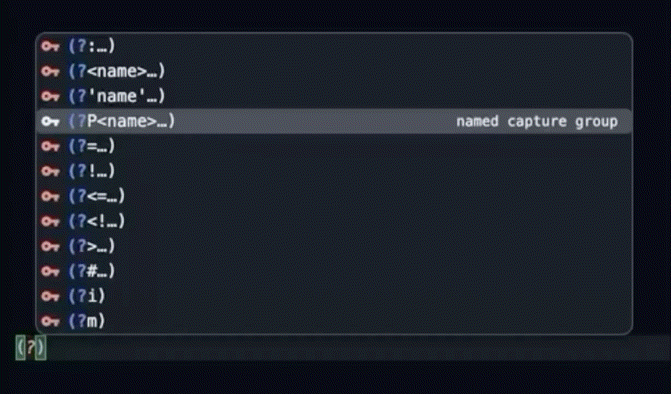

# Regular Expression for VSCode

A **Regular Expression** language for **VSCode**, adapted from the **Sublime Text** definitions that the **Textastic app** (for iOS & MacOS) uses. 

This is the VSCode companion to the [Acode plugin](https://github.com/RichNSD/Acode-Regex) and (generally) behaves the same way.

<details>
<summary><h2>Table of Contents</h2></summary>

  - [Features](#features)
    - [Syntax Highlighting](#syntax-highlighting)
    - [File Types](#file-types)
    - [Regex Flavors](#regex-flavors)
    - [Customization](#customization)
  - [Completions](#completions)
    - [Group Constructs](#group-constructs-)
    - [Escape Characters](#escape-characters-)

</details>


# Features

## Syntax Highlighting
This was the primary focus of project. Open a `.re` or `.regex` file and you get syntax highlighting for the regular expressions itself, as a scratchpad for writing and checking long expressions.



As you can see by that screenshot, the one thing that this extension adds that is technically not valid syntax is comments. That was part of the original Sublime Syntax definitions, and I really liked it, so I kept them.


> [!WARNING]
> ### ⚠️ What it does NOT do
> This is *strictly* a language pack for syntax highligting. This extension ***does not***... 
> - Run, test, or evaluate anything
> - Add highlighting to other languages
> 
> If you're looking for something to *test* regular expressions, I recommend using [Regex101](https://regex101.com).


### File Types
- `.re`
- `.regex`

### Regex Flavors
- PCRE (default)
- JavaScript
- Python

I'm also considering adding language definitions for **.NET Regular Expressions** for those working in **PowerShell** and **C#**.

### Customization
By default, the two pre-configured file extensions are set to use the PCRE syntax. You can change this, or add your own file extensions in the JSON settings using the `files.associations` property. For example:

```jsonc
// Regex Syntax File Associations
"files.associations": {
  "*.jsre": "regexp-javascript",
  "*.pyre": "regexp-python"
}
```


## Completions

### Group Constructs: `(?...)`
Adding a `?` to an empty set of `()` will initiate the following menu of completion options (which includes comments).


**Example: Named Capture Group**




### Escape Characters: `\...`
Simply inserting a `\` in most places will trigger the menu of escaped characters and classes.


---


> [!IMPORTANT]
> ### AI Transparency Notice
> This is my first time building an extension/plugin for either Acode or VSCode and I'm trying to use these extensions as a learning experience. So far all of my (self-taught) coding experience has been in the troubleshooting, editing, and fixing of things other people have built from scratch. So, I will admit that Claude Code has done most of the heavy lifting during the initial builds on both versions of this extension as I learn how everything works. However, going forward, the goal is to use as little AI as possible because my goal is to learn and improve ***my*** skills as a developer.
  
> [!NOTE]
> ### The Art is Human-Made 😎
> The logo/icon is something I designed myself though. The design files are free for anyone to use and play with in the repo. You can find them in the `/design` folder, which I made using [VectorCraft](https://getartcraft.com/apps/vectorcraft): the awesome new open-source, _legally-distinct_ version of a certain super popular, orange-themed, vector-based design software.

### VSCode Build

```sh
npm run package
```